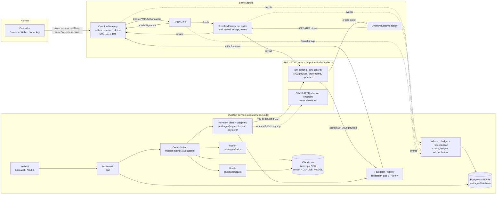

# Architecture

Agents and the Overflow service propose and sign; only three contracts move USDC (`OverflowTreasury`, `OverflowEscrowFactory`-created `OverflowEscrow` clones, and USDC itself on their instruction). USDC asks the treasury (ERC-1271) before every transfer that names the treasury as payer. Source: docs/SPEC.md, "Architecture".

Deployed on Base Sepolia (chain 84532), from `packages/schemas/deployments/base-sepolia.json`:

| Contract | Address | Deploy tx |
|---|---|---|
| OverflowTreasury | `0x03805bdE8BD8266Ad525A9eb13A0eDa7fAcaDca2` | [0xbb9fd87f…301c](https://sepolia.basescan.org/tx/0xbb9fd87f128ef5783b4765d4741001287acc4d495ee996fb9e8979db6c5b301c) |
| OverflowEscrowFactory | `0x933Bc257a24D94786D0021745470D343d3391808` | [0x17570db9…1d20f](https://sepolia.basescan.org/tx/0x17570db986b411cd99fd0f336627d23f8bb2298750537234d37d1955bb11d20f) |
| OverflowEscrow implementation | `0x16fb922f0b3aa2c09d0e5e56640f7b0fd3e14f20` | same tx as the factory |
| USDC (Circle) | `0x036CbD53842c5426634e7929541eC2318f3dCF7e` | not ours |

## Components

Notes:
- The facilitator is in-process in the service. A second adapter targets Coinbase's facilitator through `reserve()`; it is BLOCKED (docs/coinbase-feedback.md) and the running service uses the Overflow path.
- The relayer pays gas only; it is never a payer of USDC. (It currently holds 1 USDC that nothing moved; see docs/limitations.md.)
- Sellers, their datasets, the attacker and the company's books (Larkspur Research Partners) are SIMULATED.

## Trust boundaries

From docs/SPEC.md, "Trust boundaries":

| Component | Trusted to | Not trusted to |
|---|---|---|
| Claude agents | Propose purchases and sign within their node | Spend outside policy; they can be prompt-injected |
| Overflow service and facilitator | Relay, index, run the adapters | Hold funds or the owner key |
| OverflowTreasury | Enforce policy on every payment | Judge whether data is good |
| Coinbase facilitator | Submit reserved payments | Bypass policy, since USDC asks the treasury |
| Sellers (SIMULATED) | Deliver what they committed to | Anything else; escrow pays only after a reveal |
| Controller | Set policy and approve exceptions | Approve every routine payment |

Boundary rules enforced in code:
- A valid agent signature is never enough: `settle()` / `reserve()` run the policy checks, and the treasury's `isValidSignature` answers yes only for the digest it is currently settling or a stored reservation (docs/SPEC.md, "The stateful ERC-1271 gate"). A signature sent straight to USDC is refused (`test_direct_to_token_bypass_reverts`, `test_fork_directBypassReverts`; the live demo replays this bypass on Base Sepolia. Live tx: TODO (Basescan link after the live run)).
- The buyer never trusts the seller's order terms: `orchestration/seller-order-terms.ts` recomputes `termsHash` and `orderId` from the wire fields and checks `factory.predict(...)` equals the returned escrow (docs/PROGRESS.md, "SIMULATED Recourse sellers").
- Owner actions use `msg.sender == owner`; there are no `/admin` routes on the service.

## One purchase, end to end (10 steps)

From docs/SPEC.md, "One purchase, end to end". Steps 1-7 and 9 are implemented in the service (`orchestration/purchase-flow.ts`, `orchestration/delivery-watcher.ts`); steps 8 and 10 are the chain and the indexer (docs/PROGRESS.md, "end-to-end purchase flow"). The flow is exercised in tests against an in-memory fake escrow; it has **not run live on Base Sepolia** (docs/limitations.md).

1. The mission owner sets a goal and budget; Oracle extracts requirements and ranks listings.
2. Fusion merges compatible requests into one `PurchaseOrder` with allocations.
3. The seller creates the order's escrow through the factory and commits the roots and the key hash.
4. The agent downloads the ciphertext, checks `rootCipher`, and samples chunks; Oracle judges the sample.
5. The agent requests the resource; the seller's 402 names the escrow as `payTo`.
6. The payment client checks the quote against the order, and the paying node signs EIP-3009 with `from` = treasury.
7. The adapter calls `settle()` (Overflow facilitator), or calls `reserve()` and hands the payload to Coinbase's facilitator.
8. USDC asks the treasury via ERC-1271; the treasury says yes only for this checked digest; USDC moves into the escrow.
9. The seller reveals the key and the agent checks the file. `accept()` pays the seller, or a proof or timeout refunds the treasury.
10. The indexer reads events, the ledger books entries, and reconciliation confirms the chain and the books agree.

## Three financial events, kept separate

| Event | What it means | Onchain | Ledger (immediate-expense policy, docs/SPEC.md "Journal entries") | Purchase state |
|---|---|---|---|---|
| 1. Authorization | An agent may commit up to an amount for one specific order | A signed EIP-3009 authorization checked by the treasury's policy; with `reserve()` the budget is charged and a reservation stored, but no USDC moves | Reservation: no entry (memo only) | Signed / reserved; a refusal is `REJECTED` with the decoded error |
| 2. Escrow funding | USDC leaves the treasury and sits in that order's escrow | `settle()` → USDC `transferWithAuthorization` to the escrow; escrow `OrderFunded` once it holds price + bond | Debit escrow deposit, credit USDC treasury | `ESCROW_FUNDED`, set only by the indexer |
| 3. Final settlement | The seller is paid, or the treasury is refunded | `accept()` / `finalizePayout` → `PaidOut`; `claimTimeoutRefund` / `complainMismatch` / `complainPromise` → `Refunded` | Paid: debit data expense by department, credit escrow deposit. Refund: debit USDC treasury, credit escrow deposit; a forfeited bond is other income | `SETTLED` or `REFUNDED`, set only by the indexer |

Rules that keep them apart:
- The delivery watcher never sets `ESCROW_FUNDED`, `SETTLED` or `REFUNDED`; those come only from indexed chain events (docs/PROGRESS.md, "end-to-end purchase flow").
- A refund restores treasury USDC, not the agent's spent allowance (docs/SPEC.md, "Refund semantics"; `test_timeoutRefund_restoresTreasuryUsdc`).
- A payment whose outcome is unknown is never retried with a new nonce; `reconcilePayment` reads USDC `authorizationState` and the `Paid` logs first (docs/PROGRESS.md, "end-to-end purchase flow").
- Reconciliation compares `balanceOf(treasury)` with the ledger's USDC treasury account, each open escrow's balance (minus bond) with its deposit line, and requires exactly one entry per `Paid` / `PaidOut` / `Refunded`; a difference above 0.01 USDC opens an exception for the controller (docs/PROGRESS.md, `ledger/reconciliation.ts`).
